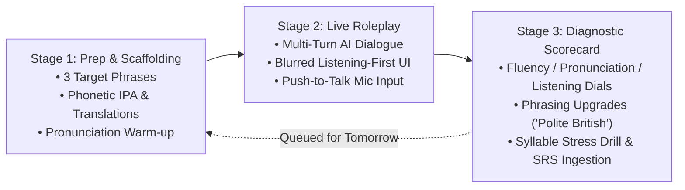

# FluencyAI (Eng Tutor) — Master Application Blueprint & Architecture Specification

> **Document Version:** 2.0.0  
> **Last Updated:** October 2026  
> **Author:** Antigravity Engineering & Product Strategy  
> **Repository:** `Eng Tutor` (`FluencyAI`)  
> **Live Production Base URL:** Hosted on GitHub Pages & VPS Cloud (`https://api.cosmowhisper.com`)

---

## Table of Contents
1. [Executive Summary & Product Vision](#1-executive-summary--product-vision)
2. [Design Philosophy & UI/UX Principles](#2-design-philosophy--uiux-principles)
3. [The Commercial & Sales Blueprint (Business Strategy)](#3-the-commercial--sales-blueprint-business-strategy)
   - 3.1 The Market Problem & The "Speaking Plateau"
   - 3.2 Competitive Differentiation Matrix
   - 3.3 Target Audiences & Personas
   - 3.4 Monetization Models & Pricing Tiers
   - 3.5 The PWA Distribution Advantage
4. [Pedagogical Engine & The 3-Stage Immersion Methodology](#4-pedagogical-engine--the-3-stage-immersion-methodology)
   - 4.1 Stage 1: Vocabulary Scaffolding & Acoustic Prep
   - 4.2 Stage 2: Live Multi-Turn Voice Roleplay (Listening-First)
   - 4.3 Stage 3: Diagnostic Scorecard & Phrasing Upgrades
5. [Core Features Deep Dive](#5-core-features-deep-dive)
   - 5.1 Multi-Persona AI Coaching Squad
   - 5.2 Interactive CEFR Placement Assessment (A1–C1)
   - 5.3 Syllable Stress & Pronunciation Radar
   - 5.4 Leitner 5-Box Spaced Repetition (SRS) Flashcard Studio
   - 5.5 60-Second Rapid-Fire Spoken Warmup
   - 5.6 AI-Powered Real-World Scenario Generator
   - 5.7 James AI Test Lab (Direct Voice Sandbox)
   - 5.8 365-Day Fluency Heatmap & Gamified Retention Loop
   - 5.9 Native Language Panic Button ("How Do I Say...?")
6. [Technical & Code Architecture](#6-technical--code-architecture)
   - 6.1 System Architecture Diagram
   - 6.2 Frontend Architecture (React 19 + TypeScript + Vite)
   - 6.3 Dual-Engine LLM Routing (FreeLLMAPI & Google Gemini)
   - 6.4 Audio & Speech Processing Pipeline
   - 6.5 Backend, Authentication & Cloud Database Sync
   - 6.6 Progressive Web App (PWA) Offline Engine
7. [Directory Structure & Codebase Map](#7-directory-structure--codebase-map)
8. [Deployment, CI/CD & Operations](#8-deployment-cicd--operations)
9. [Future Roadmap & Next Steps](#9-future-roadmap--next-steps)

---

## 1. Executive Summary & Product Vision

**FluencyAI** is a mobile-first, Progressive Web App (PWA) engineered to solve the most pervasive bottleneck in foreign language learning: **the spoken fluency plateau and speaking anxiety**.

While traditional language applications excel at teaching vocabulary lists and multiple-choice grammar rules, they leave learners paralyzed when required to participate in spontaneous, real-time verbal conversations. Conversely, private human tutors ($30–$80/hour) create scheduling friction and trigger intense evaluation anxiety for non-native speakers.

FluencyAI bridges this gap by functioning as a **hyper-realistic, judgment-free, 24/7 AI conversational immersion partner**. Combining advanced natural language models (Gemini 2.5 Flash / Gemini 3.1 Flash-Lite), browser-native speech recognition, neural British speech synthesis, and real-time acoustic visualizers, FluencyAI empowers learners to build automaticity, master polite British workplace pragmatics, and refine their accent through high-frequency, low-stakes practice.

```
       ┌────────────────────────────────────────────────────────┐
       │                       FluencyAI                        │
       │     The Anxiety-Free English Conversational Partner    │
       └───────────────────────────┬────────────────────────────┘
                                   │
         ┌─────────────────────────┼─────────────────────────┐
         ▼                         ▼                         ▼
 ┌───────────────┐         ┌───────────────┐         ┌───────────────┐
 │ Voice-First   │         │ Pedagogically │         │ Local-First & │
 │ Immersion     │         │ Structured    │         │ Multi-Device  │
 │ Real speech   │         │ 3-stage loop  │         │ 100% offline  │
 │ with neural   │         │ with instant  │         │ PWA + cloud   │
 │ TTS & visuals │         │ upgrades      │         │ DB sync       │
 └───────────────┘         └───────────────┘         └───────────────┘
```

---

## 2. Design Philosophy & UI/UX Principles

The application is built upon five foundational UI/UX tenets designed specifically for language learners:

1. **Acoustic & Psychological Safety (Zero Anxiety):**
   - Traditional voice apps intimidate users with strict timers and harsh error sounds. FluencyAI employs soothing, soft tones (calming blues, emerald greens, warm amber), soft chimes, and supportive feedback loops.
   - Learners can pause at any time, re-record answers without penalty, and consult native-language translations without leaving the scenario.

2. **Listening-First Sensory Hierarchy:**
   - In real-world verbal interactions, English speakers do not carry subtitles. In **Stage 2 (Voice Roleplay)**, the AI's transcript is intentionally blurred by default. The learner must actively listen and comprehend through the ears before tapping the eye icon to inspect the written words.

3. **Push-to-Talk (PTT) with Active Pulse:**
   - Voice Activity Detection (VAD) frequently cuts off non-native speakers who pause to formulate sentences. FluencyAI provides both continuous listening and an intuitive Push-to-Talk / Tap-to-Talk mechanic that grants the learner total agency over their speaking turns.

4. **Micro-Learning Architecture:**
   - Every scenario and daily session is calibrated for a **3 to 5-minute cognitive sprint**. By eliminating the intimidation of 45-minute tutoring sessions, users build an unbroken daily habit.

5. **Aesthetics — "Rich, Premium, and Dynamic":**
   - High-end glassmorphic cards (`bg-white/80`, `backdrop-blur-md`).
   - Radial ambient color blooms and responsive max-w-5xl layouts.
   - Dynamic real-time Web Audio frequency waveforms reacting to vocal pitch and volume.
   - Celebratory micro-interactions powered by `canvas-confetti` on milestone completion.

---

## 3. The Commercial & Sales Blueprint (Business Strategy)

### 3.1 The Market Problem & The "Speaking Plateau"
Worldwide, over 1.5 billion people are actively learning English. Yet, the vast majority experience the **"B1–B2 Intermediate Trap"**:
- They can read English news articles with ease.
- They can score 80%+ on written grammar tests.
- **Yet, in live meetings, airport check-ins, or casual pub banter, their mind goes completely blank.**

The reasons are psychological and systemic:
- **Speech Anxiety (Xenoglossophobia):** Fear of embarrassment in front of colleagues or human teachers.
- **Lack of Conversational Cadence:** Lack of practice in small talk, cultural idioms, and polite conversational turn-taking.
- **Cost & Availability Constraints:** High-quality native British/American tutoring is prohibitively expensive for recurring daily use.

### 3.2 Competitive Differentiation Matrix

| Capability | Duolingo / Babbel | Traditional 1-on-1 Tutors | FluencyAI |
| :--- | :--- | :--- | :--- |
| **Primary Interaction** | Tapping bubbles & typing | Live human video call | Natural spoken voice dialogue |
| **Conversational Freedom** | Rigid scripted drills | High (Unscripted) | High (Open LLM multi-turn) |
| **Social Pressure** | Low | **Very High** (Performance anxiety) | **Zero** (Safe, private sandbox) |
| **Cost** | ~$10/month | $30–$80 / hour | **$0–$14.99 / month** |
| **Availability** | 24/7 | Requires booking days ahead | **Instant, 24/7 on demand** |
| **Acoustic Syllable Radar** | No | Subjective | **Objective visual pitch curve** |
| **Dynamic Phrasing Upgrades**| No (Right/Wrong binary)| Irregular verbal feedback | **Contextual polite rephrasing** |
| **Install Footprint** | 150MB+ App Store download | Zoom/Skype required | **Instant 0MB PWA install** |

### 3.3 Target Audiences & Personas
1. **The International Tech / Remote Professional:** Needs to articulate status updates in agile stand-ups, challenge requirements politely, and build camaraderie with overseas colleagues.
2. **The Relocation Expat & Visa Applicant:** Moving to the UK, Ireland, Canada, or Australia; needs pragmatic daily fluency for renting flats, ordering coffee, NHS visits, and council tax inquiries.
3. **The Executive / Job Candidate:** Preparing for STAR-method behavioral interviews where polite diplomacy, articulate phrasing, and professional poise determine career trajectories.
4. **The Academic / IELTS/TOEFL Candidate:** Seeking to overcome pauses and hesitation in IELTS Part 2/3 speaking tasks.

### 3.4 Monetization Models & Pricing Tiers

FluencyAI is built to sustain three complementary revenue streams:

#### A. Direct-to-Consumer (B2C) Freemium
- **Free Tier:**
  - 1 daily lesson per day (5 minutes).
  - Access to 3 foundational roleplay scenarios (Coffee, Hotel, Office).
  - Basic Web Speech voice synthesis.
  - Local browser storage.
- **FluencyAI Pro ($14.99/month or $99/year):**
  - Unlimited voice roleplay sessions with zero turn caps.
  - Full access to all 4 AI Coach Personas (James, Emma, Oliver, Aoife).
  - Unlimited **AI Custom Scenario Generation** (generate lessons for any real-world situation).
  - Syllable Stress Radar & acoustic breakdown.
  - Multi-device cloud sync with automated database backup via VPS.
  - Full Leitner SRS Flashcard Studio access.

#### B. Enterprise & Corporate Language Training (B2B SaaS)
- Sold to multinational corporations, tech consultancies, and NHS healthcare trusts onboarding international recruits.
- Features: Manager analytics dashboard, CEFR team benchmarking, custom company-specific scenario libraries (e.g., patient handovers, internal software demos), and SSO integration.
- Pricing: **$25–$45 per seat / month**.

#### C. Language Academy / University White-Labeling
- Language schools bundle FluencyAI as their students' "between-class speaking homework" platform, dramatically boosting school retention and student exam scores.

### 3.5 The PWA Distribution Advantage
- **Zero App Store Toll:** Bypasses the 30% Apple App Store / Google Play tax, enabling higher profit margins and immediate feature rollouts.
- **Zero Install Friction:** Users click a single link and tap "Install to Home Screen" — launching as a standalone, fullscreen app within 2 seconds.
- **Offline Resilience:** With Service Worker caching, core scaffolding, flashcards, and lesson plans function seamlessly even with zero internet connectivity.

---

## 4. Pedagogical Engine & The 3-Stage Immersion Methodology

FluencyAI implements a research-backed, 3-stage pedagogical loop structured to guide learners from recognition to production, and ultimately to self-correction:



### 4.1 Stage 1: Vocabulary Scaffolding & Acoustic Prep
- **Objective:** Lower cognitive load before entering real-time conversation.
- **Mechanism:**
  - Presents exactly 3 curated target phrases essential to the scenario.
  - Each phrase includes International Phonetic Alphabet (IPA) guides, contextual cultural etiquette notes, and 1-click native translations across 8 languages.
  - Learners practice speaking each phrase into their microphone with real-time feedback until achieving acoustic confidence.
  - Previous mistakes saved to the Spaced Repetition queue are automatically injected as "Review Items" into this stage.

### 4.2 Stage 2: Live Multi-Turn Voice Roleplay (Listening-First)
- **Objective:** Develop spontaneous auditory processing and conversational agility.
- **Mechanism:**
  - The AI persona speaks using neural TTS with calibrated pitch, pace, and British RP cadence.
  - Real-time audio waveform reacts dynamically to speech frequencies.
  - **Listening-First UI:** The AI’s transcript is blurred by default. The learner is challenged to listen first; an eye toggle allows unblurring if needed.
  - **Flexible Voice Input:** Learners tap or hold the microphone button to reply. Browser speech recognition transcribes their speech with confidence scoring.
  - **Emergency Panic Button ("How Do I Say...?"):** Learners can open a bottom sheet and type in their native language (e.g. *¿Cómo digo que la cuenta está equivocada?*), receiving immediate English suggestions with phonetic pronunciation without breaking scenario immersion.

### 4.3 Stage 3: Diagnostic Scorecard & Phrasing Upgrades
- **Objective:** Convert speaking performance into actionable linguistic growth.
- **Mechanism:**
  - **Tri-Metric Dials:**
    - *Fluency Score (45% weighting):* Pacing, turn completion, and sentence formulation.
    - *Pronunciation Score (35% weighting):* Acoustic confidence, phoneme accuracy, and vowel length.
    - *Listening Score (20% weighting):* Contextual relevance and lack of reliance on transcript unblurring.
  - **Phrasing Upgrades ("What You Said" vs. "More Natural"):**
    - The AI does not merely point out grammatical errors; it upgrades serviceable English into sophisticated, culturally nuanced idioms (e.g., transforming *"I want coffee"* into *"Could I get a flat white, please?"*).
  - **Acoustic Syllable Feedback:** Low-confidence words are isolated with syllable stress breakdowns.
  - **1-Click SRS Save:** Upgraded phrases can be saved directly to the Leitner Spaced Repetition deck for automated recall in future lessons.

---

## 5. Core Features Deep Dive

### 5.1 Multi-Persona AI Coaching Squad
FluencyAI features four distinct, human-calibrated AI personas with custom vocal profiles, speech rates, and pedagogic tones:

```
┌────────────────────────────────────────────────────────────────────────┐
│                      THE FLUENCYAI COACHING SQUAD                      │
├──────────────┬─────────────────────────┬──────────┬────────────────────┤
│ Persona      │ Role & Specialty        │ Accent   │ Vocal Profile      │
├──────────────┼─────────────────────────┼──────────┼────────────────────┤
│ 🧑‍💼 James    │ London Corporate Mentor │ UK (RP)  │ Baritone (0.93x)   │
│              │ Workplace Diplomacy     │          │ Pitch 0.92         │
├──────────────┼─────────────────────────┼──────────┼────────────────────┤
│ 👩‍🏫 Emma     │ Oxford Academic Coach   │ UK       │ Patient (0.88x)    │
│              │ Literature & Nuance     │          │ Pitch 1.00         │
├──────────────┼─────────────────────────┼──────────┼────────────────────┤
│ 👨‍💻 Oliver    │ Manchester Tech Founder │ UK       │ Upbeat (1.06x)     │
│              │ Modern Banter & Slang   │          │ Pitch 1.10         │
├──────────────┼─────────────────────────┼──────────┼────────────────────┤
│ 👩‍🎨 Aoife    │ Dublin Hospitality Host │ Ireland  │ Melodic (0.94x)    │
│              │ Social Icebreakers      │          │ Pitch 1.18         │
└──────────────┴─────────────────────────┴──────────┴────────────────────┘
```

### 5.2 Interactive CEFR Placement Assessment (A1–C1)
- A friendly 3-turn interactive voice diagnostic with James.
  - *Turn 1 (A1–A2):* Everyday routine & background introduction.
  - *Turn 2 (B1–B2):* Past narrative resolution & work challenge.
  - *Turn 3 (C1):* Abstract nuance, debate, and conditional reasoning.
- Automatically evaluated by Gemini 2.5 Flash / 3.1 Flash-Lite, returning CEFR starting tier, grammar score, fluency score, strengths, and targeted recommendations.
- Automatically calibrates the vocabulary level across all subsequent roleplay sessions and syncs to the user's remote cloud profile.

### 5.3 Syllable Stress & Pronunciation Radar
- Resolves the primary reason non-native speakers are misunderstood: **incorrect syllable stress**.
- Inspects problematic words, decomposes them into syllables (e.g., *de-VE-lop-ment* vs. *DE-ve-lop-ment*), marks stressed syllables, and renders an interactive pitch curve comparing user intonation against native RP standards.

### 5.4 Leitner 5-Box Spaced Repetition (SRS) Flashcard Studio
- Built-in Spaced Repetition System based on Sebastian Leitner's algorithm:
  - *Box 1:* Daily review (newly saved mistakes).
  - *Box 2:* Review every 2 days.
  - *Box 3:* Review every 4 days.
  - *Box 4:* Review every 7 days.
  - *Box 5:* Mastered (review every 14 days).
- Flashcards support audio playback, phonetic IPA, usage context, and instant translation toggles.

### 5.5 60-Second Rapid-Fire Spoken Warmup
- A high-tempo speaking sprint to break vocal inertia before meetings or daily study.
- A 60-second timer challenges the learner to answer 3 spontaneous prompts aloud.
- Awards +50 XP and automatically logs 2 active speaking minutes into the daily goal tracker.

### 5.6 AI-Powered Real-World Scenario Generator
- Allows users to generate a completely custom 3-stage lesson plan on any topic:
  - E.g., *"Negotiating rent with a London estate agent"*, *"Returning a damaged item to Marks & Spencer"*, *"Explaining an AWS server outage to a non-technical manager"*.
  - Generates realistic personas, dialogue trees, scaffolding vocabulary, and grading rubrics on the fly.

### 5.7 James AI Test Lab (Direct Voice Sandbox)
- A dedicated testing ground enabling learners to converse directly with James without initiating a full curriculum lesson.
- Includes quick-prompt pills, live speech latency monitors (~500ms response time), mic testing, and direct pronunciation drills.

### 5.8 365-Day Fluency Heatmap & Gamified Retention Loop
- Tracks daily speaking minutes, XP earned, and active streaks across a GitHub-style 365-day activity grid.
- Dual-progress bars track daily goals (e.g., 15 minutes / 100 XP) with celebratory chimes and confetti animations upon completion.

### 5.9 Native Language Panic Button ("How Do I Say...?")
- Full native translation dictionary support across 8 major languages:
  **Spanish, Mandarin, Japanese, Portuguese, Arabic, French, Vietnamese, and German**.
- Available inside active roleplays to eliminate conversational dread.

---

## 6. Technical & Code Architecture

### 6.1 System Architecture Diagram

```
┌────────────────────────────────────────────────────────────────────────┐
│                        CLIENT LAYER (PWA)                              │
│   React 19 + TypeScript + Vite + Tailwind CSS + Web Audio + Canvas     │
├────────────────────────────────┬───────────────────────────────────────┤
│ • SpeechRecognition (Web Speech)│ • SpeechSynthesis (Neural British TTS)│
│ • AudioRecorder (MediaStream)  │ • AudioVisualizer (Analysers & Canvas)│
│ • LocalStorage (Local-First DB)│ • Service Worker Cache Engine (sw.js) │
└───────────────┬────────────────┴───────────────────┬───────────────────┘
                │                                    │
                │ /api/gateway (Proxy)               │ HTTPS REST
                ▼                                    ▼
┌─────────────────────────────────┐   ┌──────────────────────────────────┐
│        AI ROUTER LAYER          │   │         BACKEND & CLOUD          │
│ FreeLLMAPI Unified Gateway      │   │ CosmoWhisper VPS / Ra Server     │
│ (Port 31415) OR Direct Gemini   │   │ (api.cosmowhisper.com)           │
├─────────────────────────────────┤   ├──────────────────────────────────┤
│ • Gemini 3.1 Flash-Lite (~500ms)│   │ • PostgreSQL Database            │
│ • Gemini 3.5 Flash / 2.5 Flash  │   │ • Node.js / Express Engine       │
│ • Strict Anti-Thinking Filter   │   │ • JWT Authentication / Passwords │
│ • JSON Schema Scorecard Engine  │   │ • Automated Progress & XP Sync   │
└─────────────────────────────────┘   └──────────────────────────────────┘
```

### 6.2 Frontend Architecture (React 19 + TypeScript + Vite)
- **Framework:** React 19 leveraging modern concurrent features and fine-grained state updates.
- **Styling:** Tailwind CSS with Plus Jakarta Sans typography and custom animation utilities (`pulse-subtle`, `bounce-subtle`, `fade-in`, `slide-up`).
- **Icons:** `lucide-react` for clean, lightweight iconography.
- **Micro-Delights:** `canvas-confetti` and custom Web Audio synthesizer oscillators for success and streak chimes.

### 6.3 Dual-Engine LLM Routing (FreeLLMAPI & Google Gemini)
The intelligence layer operates through a unified, fault-tolerant router (`src/services/llmConfig.ts` & `src/services/geminiService.ts`):

1. **Auto-Provider Key Detection:**
   - Keys beginning with `freellma...` are locked to the **FreeLLMAPI Unified Gateway** (`http://127.0.0.1:31415/v1` via Vite reverse proxy `/api/gateway` to eliminate browser CORS and CORP restrictions).
   - Keys beginning with `AIza...` route directly to the official Google Gemini API cloud endpoints.
2. **Speed-Optimized Models:**
   - Default roleplay engine: `gemini-3.1-flash-lite` (latency ~500ms for conversational turn-taking).
   - Diagnostic grading: `gemini-2.5-flash` or fast fallback heuristic engines for instant scorecard generation under 1.2 seconds.
3. **Hardened Prompt Engineering & Zero-Budget Thinking:**
   - Few-shot roleplay prompts strictly enforce natural conversational brevity (1–3 sentences per turn).
   - Gemini thinking tags (`<thought>...</thought>`) are suppressed and regex-filtered to guarantee that internal reasoning never leaks into speech synthesis audio.

### 6.4 Audio & Speech Processing Pipeline
- **Speech Recognition (`speechRecognition.ts`):**
  - Continuous listening with pause-tolerant speech segmentation tailored for ESL speech hesitation.
  - Word-level confidence extraction (`WordConfidenceInfo`) to pinpoint mispronounced tokens.
  - Contraction and punctuation fuzzy-matching (e.g., treating *"I'm"* and *"I am"* as equivalent in scoring).
- **Speech Synthesis (`speech.ts`):**
  - Automated neural voice discovery prioritizing natural British English voices (`Ryan`, `Daniel`, `Thomas`, `Sonia`, `Google UK English Male/Female`).
  - Strict voice auditioning and pitch/speed calibration (`0.88x` to `1.06x`) per persona.
- **Acoustic Visualizer (`audioVisualizer.ts`):**
  - Real-time `AudioContext` and `AnalyserNode` frequency inspection driving dynamic SVG waveform animations.

### 6.5 Backend, Authentication & Cloud Database Sync
- **VPS Server:** CosmoWhisper VPS / Ra Server backend (`https://api.cosmowhisper.com`).
- **Stack:** Node.js, Express, TypeScript, PostgreSQL.
- **Authentication:** Dual-mode auth supporting email/password and Magic Link OTP, returning signed JWT sessions stored in both `localStorage` and `Secure; SameSite=Lax` cookies.
- **Sync Protocol (`authService.ts`):**
  - **Local-First:** The app functions 100% offline using `localStorage`.
  - When authenticated and connected, debounced background requests sync user progress (XP, streaks, CEFR level, completed scenarios, and placement data) to the PostgreSQL database.

### 6.6 Progressive Web App (PWA) Offline Engine
- **Service Worker (`public/sw.js`):**
  - Implements cache-first caching for static assets (scripts, fonts, icons, audio chimes) and stale-while-revalidate for application data.
  - Automatically checks for updates and surfaces an in-app reload banner upon new deployments.
- **Manifest (`public/manifest.webmanifest`):**
  - Configured for `display: standalone` with theme color `#0284c7` (Brand Sky Blue).
  - High-resolution icons (192px, 512px, maskable adaptive icons, Apple Touch Icon).
  - In-app install banner with step-by-step installation guides for iOS Safari and Android Chrome.

---

## 7. Directory Structure & Codebase Map

```
Eng Tutor/
├── docs/                                # Technical specifications & architecture guides
│   ├── FREELLMAPI_INTEGRATION_GUIDE.md  # Detailed FreeLLMAPI gateway post-mortem & resolution
│   └── FLUENCYAI_MASTER_BLUEPRINT.md    # Master architecture & product blueprint (This document)
├── public/                              # PWA assets & service worker
│   ├── manifest.webmanifest             # Web App Manifest for standalone mobile experience
│   ├── sw.js                            # Offline caching service worker
│   ├── apple-touch-icon.png             # iOS home screen icon
│   └── icon-*.png                       # High-res and maskable app icons
├── scripts/                             # Utility scripts
│   ├── generate-icons.js                # Canvas/Sharp icon generator
│   └── update_vps_auth.cjs              # VPS backend migration script
├── src/
│   ├── assets/                          # Static branding images & SVGs
│   ├── components/                      # Core React UI components
│   │   ├── lesson/                      # 3-Stage Pedagogical Flow
│   │   │   ├── LessonFlow.tsx           # Master stage coordinator (Prep → Roleplay → Scorecard)
│   │   │   ├── ScaffoldingStage.tsx     # Stage 1: Vocabulary & pronunciation warm-up
│   │   │   ├── RoleplayStage.tsx        # Stage 2: Real-time multi-turn voice conversation
│   │   │   ├── ScorecardStage.tsx       # Stage 3: Diagnostic dials & phrasing upgrades
│   │   │   ├── PronunciationRadarModal.tsx # Syllable stress & pitch curve visualizer
│   │   │   ├── HowDoISaySheet.tsx       # Native language emergency panic sheet
│   │   │   └── WaveformVisualizer.tsx   # Real-time audio waveform canvas
│   │   ├── AIGatewaySettingsModal.tsx   # LLM Gateway connection modal (FreeLLMAPI / Gemini)
│   │   ├── CustomScenarioModal.tsx      # AI-powered real-world scenario generator
│   │   ├── DailyGoalCard.tsx            # Daily speaking progress, streak, & XP card
│   │   ├── FluencyHeatmap.tsx           # 365-day interactive activity heatmap
│   │   ├── JamesTestAreaModal.tsx       # Direct voice sandbox lab
│   │   ├── Navbar.tsx                   # Top navigation, status pills, persona & profile toggles
│   │   ├── PersonaSelectorModal.tsx     # 4-coach persona selector modal
│   │   ├── PlacementModal.tsx           # 3-turn interactive CEFR placement diagnostic
│   │   ├── PWAInstallGuideModal.tsx     # Step-by-step iOS & Android PWA install guide
│   │   ├── RapidWarmupModal.tsx         # 60-second spoken warmup sprint
│   │   ├── RoleplayList.tsx             # Curated scenario cards catalog
│   │   ├── SRSFlashcardModal.tsx        # Leitner 5-box spaced repetition study studio
│   │   ├── ToastContainer.tsx           # Global notification toast renderer
│   │   └── UserProfileModal.tsx         # User authentication, VPS sync, & profile settings
│   ├── data/                            # Static data & curriculum definitions
│   │   ├── lessonPlans.ts               # Structured lesson plans & help phrases
│   │   ├── mockData.ts                  # Roleplay scenarios & initial user progress
│   │   └── personas.ts                  # Coach persona definitions (James, Emma, Oliver, Aoife)
│   ├── services/                        # Business logic, audio, and API clients
│   │   ├── activityService.ts           # 365-day activity logger & heatmap data persistence
│   │   ├── audioRecorder.ts             # MediaStream audio recording controller
│   │   ├── audioVisualizer.ts           # Web Audio API frequency analyzer
│   │   ├── authService.ts               # VPS authentication & cloud PostgreSQL sync
│   │   ├── geminiService.ts             # Unified LLM dialogue, scorecard & placement engine
│   │   ├── geminiTutorService.ts        # Dynamic tutor response & scorecard analysis
│   │   ├── lessonAnalysis.ts            # Scoring algorithms & heuristic phrasing upgrades
│   │   ├── llmConfig.ts                 # Dual-provider LLM gateway configuration & tester
│   │   ├── pronunciationRadar.ts        # Syllable segmentation & stress analysis
│   │   ├── speech.ts                    # Neural TTS synthesis, auditioning & audio chimes
│   │   ├── speechRecognition.ts         # ESL-tuned Web Speech recognition controller
│   │   ├── srsService.ts                # Leitner 5-box SRS flashcard logic
│   │   └── toast.ts                     # Toast notification dispatcher
│   ├── types/
│   │   └── index.ts                     # Global TypeScript interfaces & type definitions
│   ├── utils/
│   │   └── nameFormatter.ts             # Display name & avatar normalization utilities
│   ├── App.tsx                          # Root application container & modal coordinator
│   ├── main.tsx                         # React 19 entry point
│   ├── pwa.ts                           # PWA service worker registration & update listener
│   └── index.css                        # Tailwind CSS directives & global styling
├── .env.example                         # Environment configuration template
├── package.json                         # Project dependencies & scripts
├── tailwind.config.js                   # Tailwind CSS theme extensions & custom animations
└── vite.config.ts                       # Vite build config & reverse proxy definitions
```

---

## 8. Deployment, CI/CD & Operations

### 8.1 Local Development Workflow
The application adheres strictly to a **Local-First** workflow:
```powershell
# 1. Install dependencies
npm install

# 2. Start local development server (runs on http://localhost:5173)
npm run dev

# 3. Verify code quality (Oxlint fast linter)
npm run lint

# 4. Compile TypeScript & create optimized production build
npm run build

# 5. Preview production build locally
npm run preview
```

### 8.2 Production Deployment Pipeline
- **Continuous Integration:** Every commit pushed to the `main` branch triggers an automated GitHub Actions workflow (`.github/workflows/deploy.yml`):
  1. Sets up Node.js 20.
  2. Runs `npm ci` for deterministic dependency installation.
  3. Executes `oxlint` for lightning-fast linting verification.
  4. Runs `npm run build` with Vite code splitting and minification.
  5. Deploys the static bundle to **GitHub Pages** with automated cache headers.
- **VPS Cloud Backend:** The backend API (`api.cosmowhisper.com`) operates under PM2 on an Ubuntu VPS with Nginx reverse proxy, SSL certification via Let's Encrypt, and automated PostgreSQL backups.

---

## 9. Future Roadmap & Next Steps

1. **Ultra-Low Latency Speech-to-Speech (Gemini Multimodal Live API):**
   - Transition from sequential *STT → LLM → TTS* to full bidirectional WebRTC audio streaming, dropping conversational latency from ~500ms down to ~200ms.
2. **Native Mobile Shells (Capacitor / TWA):**
   - Package the proven PWA into Google Play and Apple App Store wrappers to capture organic search traffic while retaining 100% web codebase reuse.
3. **B2B Analytics Portal:**
   - Build a corporate supervisor dashboard enabling enterprise HR and language managers to track team fluency progress, average CEFR gains, and scenario completion metrics.
4. **Expanded Accent & Cultural Coaching:**
   - Introduce North American (New York, California), Australian (Sydney), and Scottish (Edinburgh) personas to prepare learners for global regional variations.

---

*FluencyAI — Speaking English with confidence, composure, and natural ease.*
